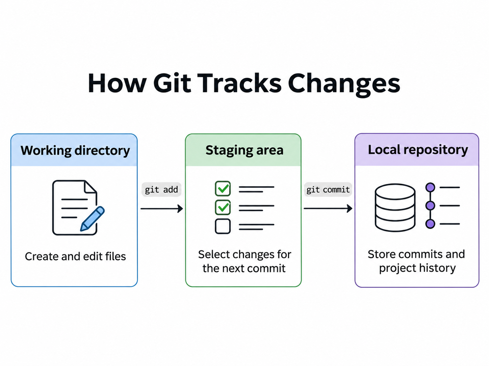

# 2.1 Git Fundamentals

According to the official Git website:

> Git is a [free and open source](https://git-scm.com/about/#free-and-open-source) distributed version control system designed to handle everything from small to very large projects with speed and efficiency.

**Source:** [Git — Official Website](https://git-scm.com/)

Git allows developers and technical writers to track changes to project files, review their work, and return to earlier versions when needed.

## How Git Tracks Changes

When you work with Git, you use three main areas to manage your changes:

- **Working directory:** This is where you create and edit your project files.
- **Staging area:** This is where you select the changes you want to include in your next commit.
- **Local repository:** This is where Git stores your commits and keeps a history of your work.



## Checking the Repository Status

Before making changes, you can check which branch you are working on and whether Git has detected any file changes.

Run:

```bash
git status -sb
```

The command uses two options:

- `-s` displays the status in a short format.
- `-b` includes the current branch name.

For example:

```text
## docs/git-fundamentals
A  docs/2-git/2.1-git-fundamentals.md
A  docs/2-git/images/how_git_tracks_changes.png
```

The first line identifies the current branch. The `A` indicator shows that Git has staged both new files for the next commit.

Staging changes does not create a commit or publish anything to GitHub.

## Understanding Git Commits

A Git commit records a snapshot of your staged changes in the local repository. Each commit has a unique identifier, called a commit hash, and a message describing the changes.

To view the most recent commit, run:

```bash
git log -1 --oneline
```

The `-1` option displays only the latest commit, while `--oneline` shows its abbreviated hash and message on a single line.

Creating a commit updates your local repository. It does not automatically publish your changes to GitHub.

### Creating a Git Commit

After editing your files, you can stage and commit the changes.

To stage the Git Fundamentals guide and its diagram, run:

```bash
git add docs/2-git/2.1-git-fundamentals.md docs/2-git/images/how_git_tracks_changes.png
```

The `git add` command prepares the file's current contents for the next commit.

To create a commit, run:

```bash
git commit -m "docs: add initial Git fundamentals guide and diagram"
```

The `-m` option lets you include a commit message directly in the command.

After committing, check the repository status:

```bash
git status -sb
```

If Git displays only the branch name, your working directory and staging area are clean.

### Local Commits and Remote Repositories

To share your commits, you push your branch to a remote repository. We cover this process in Section 2.3 — Working with Remote Repositories.
